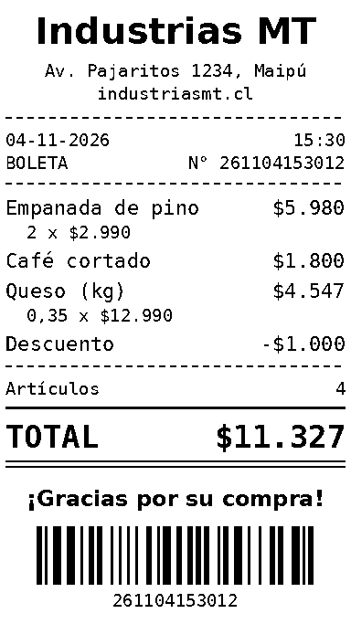

# iPreent


Offline, account-free driver for the cheap BLE thermal "mini printers" (cat-face printer,
GB01/GB02/GB03, X6, MX…) that normally need the **iPrint** / **Tiny Print** app.
No login, no internet, no vendor server. Protocol notes: [PROTOCOL.md](PROTOCOL.md).

## Downloads
Ready-made builds are on the [Releases page](https://github.com/matias-saavedra-g/iPreent/releases/latest):
the Android APK, the portable Windows exe and a zip of the command-line version. How each one is built, signed
and updated: [docs/RELEASES.md](docs/RELEASES.md).

### Android: install and update with Obtainium
[Obtainium](https://github.com/ImranR98/Obtainium) installs the APK straight from GitHub Releases and tells you
when there's a new version. With Obtainium installed, tap:

[](https://apps.obtainium.imranr.dev/redirect?r=obtainium://add/https://github.com/matias-saavedra-g/iPreent)

Or open Obtainium, tap **Add app** and paste `https://github.com/matias-saavedra-g/iPreent` as the source URL.
Each release also has a Windows exe and a zip; Obtainium only takes the `.apk`.

## Android app
`iPreent-vX.Y.Z.apk` from the Releases page (Android 8+). Material You colours, light/dark from the system.
English and Spanish, following the system language (the debug settings can force one of them).
- **Create** (home): every tool on one screen. The two you're most likely to want get big tiles (Photo and
  Document at first), the rest a compact grid. The order starts from fixed weights and slowly follows what you
  actually print; it's only recalculated when the app starts, so tiles never move while you're looking.
- **Queue**: what is printing and what's waiting, each with the time left, a progress bar and a button to remove a
  waiting job. A badge shows how many jobs are open. **History**: everything printed, to reprint.
- The **printer button** at the top right (name + gear) opens the printer settings: darkness, status and battery,
  printer details (which paper to buy, print width, resolution), find printers, forget the printer.
- **Templates**: cute designs to fill in (hearts, frames, to-do and shopping lists, notes, birthday and
  thank-you cards, gift tags, jar labels, name tags, **Christmas** and other holidays: New Year, Fiestas Patrias,
  Halloween, Valentine's, Easter, Mother's, Father's, Children's and Teachers' Day; the ones in season come
  first). Pick one from the gallery, type your text (it shrinks to
  fit; lists grow longer), print. *Your own SVG* adds any SVG file. See [docs/TEMPLATES.md](docs/TEMPLATES.md).
- Share a photo, PDF or text to iPreent from any app, or print from Chrome/Files with the iPreent print service.

## Printing while the printer is busy
These printers don't show that they're working unless you look at the paper slot, so every version tells you:
- Pressing **Print** sends a little paper slip flying into the queue, and the queue shows a countdown.
- Pressing Print again while something is still printing asks first: *The printer is busy: “Photo” is printing,
  about 0:12 left. Add “Note” to the queue? It should start in about 0:12.*
- Times come from the paper length at a fixed **10 mm/s**, the printer's slowest nominal speed, whatever the
  darkness: timing real prints wasn't reliable, and it's better to be told a print takes a bit longer than it
  does. (The listing's "40 ppm" turned out far too fast.) Prints are still timed and logged, but only to check the
  speed later; `ipreent bench` measures it on about 11 cm of paper.
- **Debug settings** change the speed the estimates use, only to test another figure (on Android they also hold the
  **Language** override): on Android tap the
  printer's name in the printer sheet 7 times; on Windows hold **Shift** while opening the printer menu
  (*Debug settings…*); on the command line `ipreent settings paper-speed 12` (`reset` goes back to 10). The
  command line and the Windows app share this setting on the same PC.
- The command line and the Windows app also wait for each other instead of fighting over the Bluetooth
  connection (`ipreent queue` shows what the other one is printing).

## Windows app (portable)
`dist/iPreent.exe` is one file, no install and no Python needed. Build it with
`pip install -e .[desktop] pyinstaller` then `python tools/build_windows.py`
(or run it from source with `ipreent-desktop`).
- Fluent look (Windows 11 style, Mica, system accent); follows the light/dark setting live.
- **Photo** and **Document** modes (pictures dithered; PDFs and text sharp by default), plus text, checklist,
  banner, QR, barcode, **receipt** and **templates** (hearts, frames, lists, cards and labels to fill in; add your
  own SVGs) modes, with an exact preview, paper length and print time. The mode list is
  ordered by how likely you are to use it (same weights as the phone).
- The printer card at the top left (or its gear) opens the printer settings: darkness, status and battery,
  printer details (paper, print width, resolution), change printer, feed paper, forget.
- The queue shows each job's countdown; pressing Print while something prints asks before queueing.
- Dithering (Atkinson, Floyd–Steinberg, sharp), darkness, brightness, contrast, pages, copies, margin trim.
- Tray menu: print clipboard (**Ctrl+Alt+P** anywhere), print file, quick note, feed paper, start with Windows.
- **Print from any app**: tray menu › *Add “iPreent” to print dialogs* (one admin prompt). This adds a printer
  named iPreent that uses Windows' built-in *Microsoft Print To PDF* driver writing to
  `C:\ProgramData\iPreent\spool\job.pdf`; the app picks each job up, trims white margins and prints it.
  The app has to be running (it lives in the tray; closing the window doesn't quit it).

### API: print from your own code
The API is off by default. Turn it on from the tray menu (*HTTP API*) or *API settings…*; it then listens on
**http://127.0.0.1:8787** while the app is open. Programs on this PC need no token, but requests from web pages
(browsers add an `Origin` header) are refused, so a website can't print on your printer. See [SECURITY.md](SECURITY.md).
Tick *Allow other devices on my network* to reach it from other machines at `http://<this PC's IP>:8787`;
then every request needs the token shown there (`Authorization: Bearer <token>` or `?token=`).
Windows Firewall may ask once to allow it.

```
curl -X POST localhost:8787/text -d "Build passed"
curl -X POST localhost:8787/print --data-binary @photo.jpg            # image, PDF or text, detected
curl -X POST "localhost:8787/print?pages=1&dither=threshold" --data-binary @ticket.pdf
curl -X POST localhost:8787/checklist -H "Content-Type: application/json" -d '{"title":"Today","items":["a","b"]}'
curl -X POST localhost:8787/qr -d "https://example.com"
curl -X POST localhost:8787/banner -d "HAPPY BIRTHDAY"
curl -X POST localhost:8787/barcode -d "ORDER-12345"                     # Code 128
curl -X POST localhost:8787/receipt -H "Content-Type: application/json" \
     -d '{"business":"My shop","items":[{"name":"Coffee","price":1800,"qty":2}]}'   # see Receipts
curl -X POST localhost:8787/template -H "Content-Type: application/json" \
     -d '{"name":"birthday","values":{"name":"Yuliana"}}'                    # GET /templates lists them
curl -X POST "localhost:8787/feed?lines=100"
curl localhost:8787/status        # printer + queue
curl localhost:8787/jobs/3        # queued | printing | done | failed, "seconds": time estimate
```
```python
import requests
requests.post("http://127.0.0.1:8787/text", data="Hello from Python")
```
Options on any print: `dither=atkinson|floyd|threshold`, `darkness=1..5`, `copies`, `pages=1-2,5`, `trim=0|1`,
`rotate=0|1`, `brightness=-50..50`, `contrast=50..200`, `wait=1` (reply only once it's printed).
Missing options use the app's current settings. Replies are JSON; errors come with a 4xx code and `{"error": ...}`.

## Command line: Windows 11 (also Linux / macOS)
1. Install Python 3.10+ from python.org (tick "Add to PATH").
2. In this folder: `pip install .`
3. Turn the printer on (hold power 3 s) and close the phone app (one connection at a time).
4. Run `ipreent scan` to see the name. Then it depends on the model:
   - **Bluetooth LE models** (GB01, X6, …): don't pair; ipreent connects directly.
   - **SC03h** (cat-face printer): works over BLE too (checked on hardware), so no pairing needed.
   - **Other serial models** (`Mini Printer`, X6H, … the app's `useSPP` flag): pair it in
     *Settings → Bluetooth & devices → Add device*. Windows creates a COM port
     (*More Bluetooth settings → COM Ports*, the "Outgoing" one). ipreent looks for it on its own,
     or pass it yourself:

```
ipreent -p COM5 -m SC03h text "hello"
```

After the first successful print the printer is remembered, so later commands connect directly.

```
ipreent scan                        # find printers, show model and connection type
ipreent print photo.jpg notes.txt   # images, PDFs, text files; several at once
ipreent print doc.pdf --pages 1-2   # PDF pages, scaled to the paper width
ipreent print qr.png --no-dither    # crisp black/white for QR codes and line art
ipreent text "Hello world"          # text from arguments...
echo "from a script" | ipreent text # ...or stdin
ipreent status --json               # state + battery, machine-readable
ipreent feed 100                    # feed blank paper
ipreent preview doc.pdf             # PNG of exactly what would print (no printer needed)
ipreent forget                      # forget the remembered printer
ipreent                             # overview: printer, settings, queue, most used commands
ipreent queue --watch               # what is printing (here or in the Windows app) and the time left
ipreent settings darkness darker    # default darkness; `ipreent settings` lists all settings and printer details
ipreent bench                       # time short strips at 3 darkness levels to measure the real speed
ipreent receipt -b "My shop" -i "Coffee" 1800 2 -i "Bread" 1.200   # see Receipts below
ipreent template                    # cute designs: hearts, frames, lists, cards, tags, Christmas (docs/TEMPLATES.md)
ipreent template big-heart "Te quiero"              # print one with your text
ipreent template to-do "Hoy" "Leche\nPan\nCafé"      # boxes in order; \n = new line
ipreent template birthday --set name=Yuliana --preview cake.png
```
Options can go before or after the command (`ipreent text hi --ble`).
If the printer is busy, it asks *Add this print to the queue? [Y/n]* and waits its turn with a countdown;
`-y` queues without asking (scripts and pipes never get asked), `--no-wait` gives up instead.
Common options: `-n 3` copies, `--size 40` bigger text, `--energy` darker/lighter, `--speed`.

### From Python
```python
import ipreent
ipreent.print_text("Build passed")
ipreent.print_file("label.pdf", copies=2)
print(ipreent.status())   # {'model': 'SC03h', 'state': 'ready', 'battery': 87}
```

Too light or too dark? Try `--energy 5000` (light) up to `--energy 17500` (dark), or a lower
`--speed`. If you see garbage instead of an image, try `--no-rle`.
If the name isn't recognized, it uses safe defaults (384 dots, uncompressed lines). Force a model with `-m GB03`.

## Receipts


Every version (command line, Windows app, Android app, HTTP API) has a receipt mode: business name, address
and website at the top, then each product with its quantity and price, the number of items, a big **TOTAL**
in Chilean pesos (`$12.990`: dot for thousands, no decimals) and a Code 128 barcode at the bottom.
- Prices accept `12990`, `12.990` or `$12.990`; a minus sign makes a discount line (`-1.000`).
  Quantities can be decimals for things sold by weight (`0,35` or `0.35`); amounts are rounded to the peso.
- The receipt number is the date and time it prints (`261104153012` = 2026-11-04 15:30:12), and the barcode
  holds that number. Nothing is stored, so there is no counter to keep in sync between the phone and the PC
  and no server. `--number` (CLI) or `"number"` (API) prints your own order number instead.
- Labels are in Spanish (`BOLETA`, `Artículos`, `TOTAL`, footer `¡Gracias por su compra!`). It is only a printout
  on plain thermal paper, not a valid SII tax document.
- Business, address, website and footer message are remembered on each device. The Windows and Android apps
  also keep the product list until you change it.

```
ipreent receipt -b "Industrias MT" --addr "Av. Pajaritos 1234, Maipú" --url industriasmt.cl \
                -i "Empanada de pino" 2990 2 -i "Café cortado" 1.800
ipreent receipt -i "Coffee" 1800            # business details remembered from last time
ipreent receipt --items-file sale.csv       # rows: name,price[,qty]; a header row is skipped
ipreent receipt --json sale.json --preview receipt.png    # check it without a printer
```
API: `POST /receipt` with `{"business", "address", "url", "footer", "number", "items": [{"name", "price", "qty"}]}`;
the reply adds `"number"` and `"total"`. Receipts always print sharp (no dithering).
<br clear="right">

## Layout
Full map, shared logic between the apps and where each app keeps its settings: [docs/ARCHITECTURE.md](docs/ARCHITECTURE.md).
- `ipreent/protocol.py` – frames, CRC, line encoding (pure, tested against vendor bytes)
- `ipreent/models.py` + `models.json` – 187 model profiles taken from the vendor app
- `ipreent/imaging.py` – image/text → 1-bit rows
- `ipreent/receipt.py` – receipts: CLP prices, totals, layout (`android/.../Receipt.kt` draws the same)
- `ipreent/ble.py` / `spp.py` – Bluetooth LE and Bluetooth serial transports
- `ipreent/api.py` – discovery, remembered printer, job building, print-time estimate; `cli.py` on top
- `ipreent/busy.py` – one print at a time across programs (OS file lock + `busy.json` describing the job)
- `ipreent/features.py` – tool weights and usage counts that order the home screens (`android/.../Features.kt`)
- `ipreent/convert.py` – file type detection, PDF rendering (pypdfium2)
- `ipreent/desktop/` – Windows app (PySide6): `app.py` window + tray, `worker.py` Bluetooth thread, `spool.py` print-dialog printer, `server.py` HTTP API
- `tools/build_windows.py` – builds `dist/iPreent.exe` (PyInstaller)
- `tools/extract_models.py` – regenerate `models.json` from a jadx decompile

## License
[MIT](LICENSE). `models.json` holds printer parameters read from the vendor app for interoperability.
